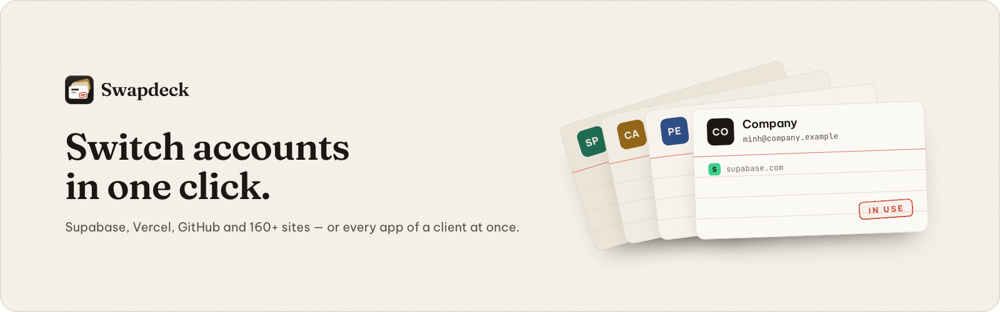

<p align="center"></p>

<p align="center">
  <a href="https://github.com/Tanx-1811/swapdeck/actions/workflows/ci.yml"></a>
  <a href="LICENSE"></a>
  <a href="https://github.com/Tanx-1811/swapdeck/releases/latest"></a>
</p>

<p align="center">
  <b>Đổi tài khoản chỉ với một cú nhấp · Switch accounts in one click</b><br>
  <a href="#tiếng-việt">Tiếng Việt</a> · <a href="#english">English</a> · <a href="#development">Development</a> · <a href="docs/ARCHITECTURE.md">Architecture</a> · <a href="docs/PRIVACY.md">Privacy</a> · <a href="CONTRIBUTING.md">Contributing</a> · <a href="desktop/README.md">Desktop app</a>
</p>

## Tiếng Việt

**Swapdeck** là tiện ích Chrome (Manifest V3) giúp bạn dùng nhiều tài khoản trên cùng một trang web — Supabase, Vercel,
GitHub, Netlify, ChatGPT… hay bất kỳ trang nào bạn đăng nhập — và chuyển qua lại chỉ với một cú nhấp. Quản lý nhiều
khách hàng, công ty hay dự án? Gom tài khoản của mỗi **bên** lại, rồi một cú nhấp đổi **mọi ứng dụng** sang bên đó.
Không cần đăng xuất, không gõ lại mật khẩu, không cần thêm hồ sơ Chrome.

### Tính năng

- **Chuyển tài khoản trong một cú nhấp** từ nút trên thanh công cụ, menu chuột phải, phím tắt `Alt+Shift+S` (tài khoản
  kế tiếp) hoặc thanh địa chỉ (gõ `swd`, dấu cách, rồi tên tài khoản hay tên bên). Mở Swapdeck bằng `Alt+Shift+A`,
  chuyển nhanh bằng phím `1`–`9`.
- **Các bên:** mỗi bên là một khách hàng, công ty hoặc dự án — gồm tài khoản dùng trên từng ứng dụng. Một cú nhấp đổi
  mọi ứng dụng của bên đó: ứng dụng của tab hiện tại đổi ngay trong tab, ứng dụng đang mở tải lại với tài khoản mới,
  ứng dụng không mở được đổi ngầm (không mở thêm tab nào). Tạo bên bằng tay, từ **tài khoản đang dùng**, hoặc từ **gợi
  ý theo tên miền email** (mọi tài khoản `@acme.io` → bên "Acme"). **Mở bên** mở luôn các trang làm việc của bên đó
  trong một nhóm tab có tên và màu riêng.
- **Popup rộng** (720 px, tự bật khi có từ 3 ứng dụng): mọi ứng dụng bên trái, tài khoản bên phải, thanh chọn bên ở
  trên, và **ô tìm kiếm chung** cho bên, ứng dụng và tài khoản. Đổi tài khoản của ứng dụng khác ngay từ popup mà không
  rời trang đang xem.
- **Bảng bên (side panel):** Swapdeck mở cố định cạnh trang và đi theo tab đang xem — tiện khi đổi tài khoản liên tục.
  Có thể đặt nút trên thanh công cụ mở thẳng bảng bên.
- **Supabase là trọng tâm:** nhận ra tài khoản dashboard đang đăng nhập, nhớ các **dự án gần đây** và **trang đã ghim**
  của từng tài khoản để mở thẳng một dự án bằng đúng tài khoản.
- **164 ứng dụng có sẵn** trong 11 nhóm — backend & dữ liệu (Supabase, Neon, PlanetScale, MongoDB Atlas, Clerk…),
  hosting (Vercel, Netlify, Cloudflare, Railway…), cloud & máy chủ (AWS, DigitalOcean, Vultr, Hetzner…), công cụ lập
  trình (GitHub, GitLab, Atlassian, Docker Hub, npm, Sentry…), AI (ChatGPT, Claude, Cursor, Perplexity, DeepSeek…),
  công việc & nhóm (Slack, Notion, Linear, ClickUp…), thiết kế (Figma, Canva, Framer…), kinh doanh (Stripe, PayPal,
  Resend, PostHog, Namecheap…), cửa hàng online (Shopify, Etsy…), mạng xã hội (Facebook, X, TikTok, LinkedIn…) và
  **Việt Nam** (Shopee Kênh Người Bán, Lazada, Tiki, Pancake, Haravan, Sapo, Nhanh.vn, GHN, GHTK, Viettel Post, Ahamove,
  MISA AMIS, Base.vn, MoMo, ZaloPay Merchant, Mắt Bão, PA Việt Nam, iNET, Tenten, Bizfly Cloud). **Chọn nhiều** ứng dụng
  rồi thêm một lần (chỉ hỏi quyền một lần), và **thêm được mọi trang web khác** — kể cả ứng dụng của chính bạn (tự nhận
  ra phiên Supabase `sb-*-auth-token`, Firebase hoặc JWT có email) — ngay từ popup bằng nút **Thêm trang này**.
- **Đăng nhập tài khoản khác** an toàn: Swapdeck lưu phiên hiện tại rồi đưa bạn tới trang đăng nhập; tài khoản mới
  đăng nhập được **tự lưu** (ở các trang Swapdeck nhận ra được tài khoản; trang khác thì bấm "Lưu phiên này").
- **Giữ phiên luôn mới:** trong lúc bạn dùng một tài khoản, bản lưu của nó được làm mới, nên chuyển về không bị phiên
  cũ.
- **Không bao giờ lưu nhầm:** Swapdeck đọc ai đang đăng nhập từ dữ liệu đăng nhập và không bao giờ lưu phiên của người
  này vào tài khoản của người khác.
- **Huy hiệu trên biểu tượng** cho biết tài khoản đang dùng ở tab hiện tại; thông báo nhỏ trên trang sau mỗi lần chuyển.
- **Khóa bằng mật khẩu** (tùy chọn): các phiên đã lưu được mã hóa (RSA-OAEP + AES-256-GCM, khóa sinh từ mật khẩu bằng
  PBKDF2); vẫn lưu được khi đang khóa, chỉ cần mật khẩu để khôi phục. Tự khóa sau một khoảng thời gian. Swapdeck nhắc
  bật khoá khi bạn đã lưu từ hai tài khoản.
- **Tài khoản quan trọng** (production, tài khoản thật của khách): nhãn đỏ, dải cảnh báo đỏ trên mọi trang của ứng dụng
  khi đang dùng tài khoản đó, và hỏi lại trước khi chuyển sang — đỡ thao tác nhầm tài khoản.
- **Sao lưu & chuyển máy:** xuất/nhập tệp sao lưu, kèm phiên đăng nhập (được mã hóa bằng mật khẩu bạn chọn).
- Trang quản lý đầy đủ: tổng quan, các bên, ứng dụng & tài khoản, lịch sử, sao lưu, bảo mật, cài đặt, hướng dẫn.
  **Tiếng Việt và tiếng Anh**. Giao diện riêng **“sơn mài & giấy dó”** (mực trên giấy ấm, sơn mài đen, dấu son
  “đang dùng”), sáng/tối, bốn màu nhấn.

### Swapdeck Desktop: mỗi bên một hồ sơ Chrome

Muốn tách hẳn từng bên? [**Swapdeck Desktop**](desktop/README.md) là app trên thanh menu macOS: mỗi bên là một hồ sơ
Chrome riêng, một cú nhấp (hoặc <kbd>⌃⌥B</kbd>) đưa cửa sổ của bên lên trước. Không chép phiên đăng nhập nào, mở được
nhiều bên cạnh nhau, đăng nhập Google vẫn chạy. Tiện ích này vẫn hữu ích bên trong từng hồ sơ khi một bên có nhiều tài
khoản trên cùng một dịch vụ.

### Cài đặt

**Từ bản phát hành:** tải `swapdeck-<phiên bản>.zip` ở trang [Releases](https://github.com/Tanx-1811/swapdeck/releases/latest)
và giải nén. Mở `chrome://extensions`, bật **Chế độ dành cho nhà phát triển**, bấm **Tải tiện ích đã giải nén** và chọn
thư mục vừa giải nén. Cần Chrome 116 trở lên.

**Từ mã nguồn:**

```sh
git clone https://github.com/Tanx-1811/swapdeck.git
cd swapdeck
npm ci
npm run build
```

Rồi tải **thư mục `dist`** như trên (không phải thư mục dự án). Sau khi cập nhật mã, chạy lại `npm run build` rồi bấm
nút tải lại trên thẻ Swapdeck.

### Cách dùng

1. Mở Swapdeck (`Alt+Shift+A`) → **Thêm Supabase** (hoặc trang khác) và cho phép truy cập đúng trang đó. Muốn thêm
   nhiều ứng dụng: trang quản lý → **Thêm ứng dụng** → **Chọn nhiều**.
2. Mở trang khi đang đăng nhập: Swapdeck tự lưu tài khoản ấy.
3. Bấm **Đăng nhập tài khoản khác**, đăng nhập tài khoản thứ hai — nó cũng được lưu.
4. Từ giờ chỉ cần bấm vào tài khoản trong popup để chuyển.
5. Làm việc cho nhiều bên? Trang quản lý → **Các bên** → **Tạo bên mới** (chọn tài khoản cho từng ứng dụng), hoặc bấm
   **Tạo** ở một gợi ý. Sau đó bấm tên bên trên thanh **Bên** của popup để đổi mọi ứng dụng cùng lúc.

| Phím tắt / thao tác                                   | Tác dụng                                                                              |
| ----------------------------------------------------- | ------------------------------------------------------------------------------------- |
| `Alt+Shift+A`                                         | Mở Swapdeck (popup, hoặc bảng bên nếu bạn chọn trong Cài đặt)                         |
| `Alt+Shift+S`                                         | Tài khoản kế tiếp của trang hiện tại                                                  |
| `1`–`9`, `/`, `↑` `↓`                                 | Trong popup: chuyển nhanh, tìm kiếm, di chuyển                                        |
| `swd` + dấu cách trên thanh địa chỉ                   | Gõ tên tài khoản hoặc tên bên rồi Enter                                               |
| Chuột phải trên nút Swapdeck                          | Đổi bên, mở bảng bên                                                                  |
| Chưa gán phím (đặt ở `chrome://extensions/shortcuts`) | Tài khoản trước, đăng nhập tài khoản khác, bên kế tiếp, mở bảng bên, mở trang quản lý |

### Cách hoạt động

Trang web biết bạn là ai nhờ dữ liệu đăng nhập trong trình duyệt (cookie và bộ nhớ của trang). Swapdeck giữ một bản sao
dữ liệu đó cho mỗi tài khoản. Khi chuyển, nó đưa tab sang một trang tĩnh của chính trang web đó (vd. `/robots.txt`, với
script của trang bị chặn), lưu phiên hiện tại vào đúng tài khoản, đặt phiên của tài khoản được chọn vào, rồi mở lại
trang. Đổi cả một bên là làm việc đó lần lượt cho từng ứng dụng; ứng dụng không có tab nào đang mở được đổi trong một tab
ẩn, đóng lại khi xong. Chi tiết: [docs/ARCHITECTURE.md](docs/ARCHITECTURE.md).

### Lưu ý quan trọng

- **Đừng bấm "Đăng xuất" trên trang web.** Đăng xuất kết thúc phiên trên máy chủ, nên bản đã lưu cũng hết hiệu lực
  (Supabase mặc định đăng xuất mọi phiên của tài khoản). Hãy dùng **Đăng nhập tài khoản khác**.
- Nếu bạn đăng nhập bằng **GitHub/Google**, trang đăng nhập có thể tự dùng tài khoản GitHub/Google đang đăng nhập. Hãy
  thêm GitHub vào Swapdeck để đổi luôn, hoặc chọn tài khoản khác ở trang của nhà cung cấp.
- **Google, YouTube, Microsoft và Apple** không được hỗ trợ: chính Chrome dùng đăng nhập của các trang này (và chúng có
  sẵn tính năng đổi tài khoản).
- Không chạy trong cửa sổ ẩn danh.

### Quyền riêng tư

Mọi thứ nằm trên máy của bạn: không tài khoản, không máy chủ, không thống kê; Swapdeck không gửi dữ liệu của bạn đi
đâu (ngoài việc mở chính các trang bạn chuyển, nó chỉ tải ảnh đại diện tài khoản từ địa chỉ do trang đó cung cấp). Khi
cài, Swapdeck không có quyền trên trang web nào; mỗi ứng dụng bạn thêm chỉ xin quyền đúng tên miền của nó. Xem
[docs/PRIVACY.md](docs/PRIVACY.md).

### Dành cho lập trình viên

`npm run dev` (build liên tục), `npm run build`, `npm test`, `npm run test:e2e`, `npm run lint`, `npm run typecheck`,
`npm run package` (đóng gói `release/swapdeck-<version>.zip`). Xem đầy đủ ở [Development](#development).

## English

**Swapdeck** is a Chrome extension (Manifest V3) for using several accounts on the same website — Supabase, Vercel,
GitHub, Netlify, ChatGPT… or any site you sign in to — and switching between them in one click. Working for many
clients, companies or projects? Group each one's accounts into a **workspace** and switch **every app** to it in one
click. No signing out, no retyping passwords, no extra Chrome profiles.

### Features

- **One-click switching** from the toolbar button, the right-click menu, `Alt+Shift+S` (next account) or the address bar
  (type `swd`, a space, then an account or workspace name). Open Swapdeck with `Alt+Shift+A`; press `1`–`9` to switch.
- **Workspaces:** a workspace is a client, company or project — the account it uses on each app. One click switches
  every app of it: the current tab's app switches in that tab, apps with open tabs reload with the new account, apps
  that aren't open switch in the background (no new tabs). Make them by hand, from the **accounts in use**, or from
  **suggestions by email domain** (every `@acme.io` account → "Acme"). **Open workspace** also opens its pages together
  in a named, coloured tab group.
- **Wide popup** (720 px, automatic with three or more apps): every app on the left, its accounts on the right, the
  workspace bar on top and one **search box** for workspaces, apps and accounts. Switch another app's account from the
  popup without leaving the page you're on.
- **Side panel:** Swapdeck stays open next to the page and follows the active tab — handy when you switch all day. The
  toolbar button can open it directly.
- **Supabase first:** recognises the signed-in dashboard account and remembers each account's **recent projects** and
  **pinned pages**, so you open a project with the right account directly.
- **164 built-in apps** in 11 groups — backend & data (Supabase, Neon, PlanetScale, MongoDB Atlas, Clerk…), hosting
  (Vercel, Netlify, Cloudflare, Railway…), cloud & servers (AWS, DigitalOcean, Vultr, Hetzner…), developer tools (GitHub,
  GitLab, Atlassian, Docker Hub, npm, Sentry…), AI (ChatGPT, Claude, Cursor, Perplexity, DeepSeek…), work & teams
  (Slack, Notion, Linear, ClickUp…), design (Figma, Canva, Framer…), business (Stripe, PayPal, Resend, PostHog,
  Namecheap…), online stores (Shopify, Etsy…), social (Facebook, X, TikTok, LinkedIn…) and **Vietnam** (Shopee Kênh
  Người Bán, Lazada, Tiki, GHN, GHTK, MISA AMIS, MoMo, Mắt Bão…). **Select several** and add them at once (one permission
  prompt), and add **any other site** — your own apps included (supabase-js `sb-*-auth-token`, Firebase and
  JWT-with-email sessions are recognised automatically) — straight from the popup with **Add this site**.
- **Sign in with another account** safely: the current session is saved first, then you land on the sign-in page; the
  new account is **saved automatically** once you sign in (on sites where Swapdeck recognises the account; elsewhere,
  press "Save this session").
- **Fresh sessions:** while you use an account, its saved session is refreshed, so switching back never restores an
  outdated sign-in.
- **Never filed under the wrong account:** Swapdeck reads who is signed in from the sign-in data and never saves one
  person's session into another person's account.
- **Toolbar badge** with the current tab's account, and a small confirmation on the page after each switch.
- **Passphrase lock** (optional): saved sessions are encrypted (RSA-OAEP + AES-256-GCM, passphrase-derived key with
  PBKDF2). Saving still works while locked; restoring needs the passphrase. Auto-lock after a while. Swapdeck reminds
  you to turn it on once two accounts are saved.
- **Important accounts** (production, a client's live account): a red label, a red warning strip on every page of the
  app while that account is in use, and a confirmation before switching to it.
- **Backup & move:** export/import a backup file, with sessions encrypted by a password you choose.
- A full manager: overview, workspaces, apps & accounts, history, backup, security, settings, help. **English and
  Vietnamese**. Its own **lacquer & paper** look (ink on warm paper, black lacquer, a vermilion "in use" seal), light
  and dark, four accent colors.

### Swapdeck Desktop: one Chrome profile per workspace

Want each workspace fully apart? [**Swapdeck Desktop**](desktop/README.md) is a macOS menu bar app that keeps each
workspace in its own Chrome profile and brings its window forward in one click (or <kbd>⌃⌥B</kbd>). No sign-in is ever
copied, workspaces can sit side by side, and "Sign in with Google" keeps working. This extension stays useful inside a
profile when one workspace has several accounts on the same service.

### Install

**From a release:** download `swapdeck-<version>.zip` from [Releases](https://github.com/Tanx-1811/swapdeck/releases/latest)
and unzip it. Open `chrome://extensions`, turn on **Developer mode**, click **Load unpacked** and pick the unzipped
folder. Requires Chrome 116 or later.

**From source:**

```sh
git clone https://github.com/Tanx-1811/swapdeck.git
cd swapdeck
npm ci
npm run build
```

Then load the **`dist` folder** the same way (not the project folder). After pulling changes, run `npm run build` again
and press the reload icon on the Swapdeck card.

### Usage

1. Open Swapdeck (`Alt+Shift+A`) → **Add Supabase** (or another site) and allow access to that site only. To add many
   apps: manager → **Add app** → **Select several**.
2. Open the site while signed in: Swapdeck saves that account automatically.
3. Press **Sign in with another account** and sign in with your second account — it is saved too.
4. From now on, click an account in the popup to switch.
5. Working for several clients? Manager → **Workspaces** → **New workspace** (pick the account for each app), or
   **Create** one of the suggestions. Then click its name in the popup's **Workspaces** bar to switch every app at once.

| Shortcut / gesture                                       | What it does                                                                        |
| -------------------------------------------------------- | ----------------------------------------------------------------------------------- |
| `Alt+Shift+A`                                            | Open Swapdeck (the popup, or the side panel if you chose it in Settings)            |
| `Alt+Shift+S`                                            | Next account of the current site                                                    |
| `1`–`9`, `/`, `↑` `↓`                                    | In the popup: switch, search, move                                                  |
| `swd` + space in the address bar                         | Type an account or workspace name, then Enter                                       |
| Right-click the Swapdeck button                          | Switch workspace, open the side panel                                               |
| Unassigned (set them in `chrome://extensions/shortcuts`) | Previous account, sign in with another account, next workspace, side panel, manager |

### How switching works

A site knows who you are from its sign-in data in your browser (cookies and the site's storage). Swapdeck keeps a copy
of that data per account. To switch, it moves the tab to a static page of the same site (e.g. `/robots.txt`, with the
site's scripts blocked), saves the current session to the account it belongs to, puts the chosen account's session in
place and reopens the site. Switching a workspace does this for each of its apps in turn; apps without an open tab
switch in a hidden tab that closes when done. Details: [docs/ARCHITECTURE.md](docs/ARCHITECTURE.md).

### Good to know

- **Don't press the site's "Sign out".** Signing out ends the session on the site's server, so the saved copy stops
  working too (Supabase signs out all of the account's sessions by default). Use **Sign in with another account**.
- If you sign in **with GitHub or Google**, the sign-in page may reuse the provider account you're signed in to. Add
  GitHub to Swapdeck to switch it too, or pick another account on the provider's page.
- **Google, YouTube, Microsoft and Apple** accounts aren't supported: Chrome itself relies on their sign-in (and they
  have their own account switchers).
- Incognito windows aren't supported.

### Privacy

Everything stays on your computer: no account, no server, no analytics, and Swapdeck sends your data nowhere (besides
opening the sites you switch, it only loads account pictures from the address the site itself provides). At install
Swapdeck has access to no website; each app you add asks for its own domains only. See
[docs/PRIVACY.md](docs/PRIVACY.md).

## Development

Stack: React 19, TypeScript, Vite 8, Vitest, Playwright (Chrome for Testing), ESLint, Prettier. Node 24.

| Command                           | What it does                                                                                       |
| --------------------------------- | -------------------------------------------------------------------------------------------------- |
| `npm run dev`                     | Rebuilds `dist/` on every change (development mode)                                                |
| `npm run build`                   | Typecheck + production build into `dist/` (load it unpacked)                                       |
| `npm run build:e2e`               | Build into `dist-e2e/` with host access granted up front, for end-to-end tests                     |
| `npm run lint`                    | ESLint                                                                                             |
| `npm run format:check`            | Prettier check (`npm run format` to fix)                                                           |
| `npm run typecheck`               | `tsc -b`                                                                                           |
| `npm test`                        | Unit tests (Vitest, `tests/unit/`)                                                                 |
| `npm run test:e2e`                | Builds `dist` and `dist-e2e`, then runs Playwright (`tests/e2e/`) against both                     |
| `npm run package`                 | Production build zipped to `release/swapdeck-<version>.zip` (refuses builds with host permissions) |
| `npm run icons`                   | Toolbar icons from `assets/icon-small.svg` (16/32 px) and `assets/icon.svg` (48/128 px)            |
| `npm run brand`                   | Logos, store promo tiles and social images in `brand/` (offline, any OS)                           |
| `npm run screenshots`             | Store screenshots from the e2e build                                                               |
| `node scripts/verify-presets.mjs` | Checks every built-in preset against the live sites (needs network; pass ids to check a few)       |

End-to-end tests run on Chrome for Testing (`npx playwright install chromium` once); official Chrome doesn't load
unpacked extensions from the command line. Every `*.test` host resolves to a local test server with a fake app that has
a real sign-in.

### Project layout

```
src/
  background/   service worker: switching engine, workspaces, watcher, state queue, vault & backups, menus, omnibox, badge
  core/         pure logic: types, presets, domains, identity detection, save decisions, workspaces, search, crypto, validation
  shared/       storage layout, typed messaging, app helpers
  popup/        the switcher (Switcher.tsx): toolbar popup, compact or wide; also used by the side panel
  sidepanel/    side panel entry (same switcher, follows the active tab)
  options/      full-page manager (hash routes #/workspaces, #/apps, #/add, #/security, …)
  ui/, styles/  shared React components, hooks, design tokens (light/dark, accents), bundled fonts
  i18n/         English and Vietnamese strings
  manifest.ts   manifest.json generator
public/         _locales and icons
assets/         icon sources
brand/          brand kit (see brand/README.md)
scripts/        icons, packaging, brand rendering, live preset check (verify-presets.mjs)
tests/          unit/ (Vitest) and e2e/ (Playwright)
docs/           ARCHITECTURE, PLAN, PRIVACY, STORE_LISTING
desktop/        Swapdeck Desktop, the macOS menu bar app (Swift; see desktop/README.md)
```

## Contributing

Swapdeck is a community project: bug reports, site requests, translations and pull requests are welcome. Start with
[CONTRIBUTING.md](CONTRIBUTING.md); please follow the [code of conduct](CODE_OF_CONDUCT.md) and report security problems
privately ([SECURITY.md](SECURITY.md)).

Dự án cộng đồng: rất hoan nghênh báo lỗi, đề xuất trang mới, dịch thuật và pull request — xem
[CONTRIBUTING.md](CONTRIBUTING.md).

## License

[MIT](LICENSE) © 2026 Tanx-1811 and the Swapdeck contributors. The bundled fonts (Be Vietnam Pro, Fraunces, JetBrains
Mono) are under the SIL Open Font License 1.1; see `public/THIRD_PARTY_NOTICES.txt`.
