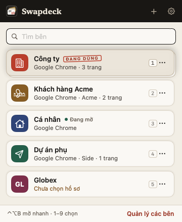
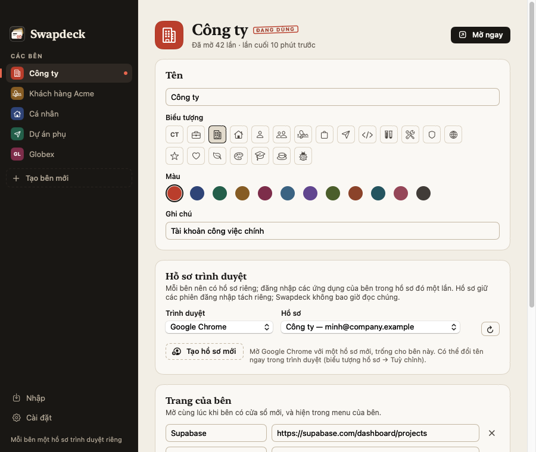
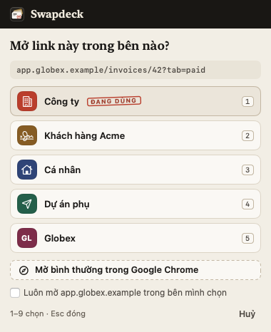
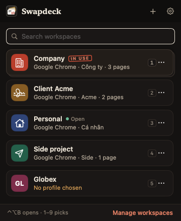

# Swapdeck Desktop

<p>
  
  
</p>

**Tiếng Việt** · [English](#english)

App trên thanh menu macOS: **mỗi bên (khách hàng, công ty, dự án) là một hồ sơ trình duyệt riêng**. Một cú nhấp — hoặc
<kbd>⌃⌥B</kbd> rồi số <kbd>1</kbd>–<kbd>9</kbd> — đưa cửa sổ của bên đó lên trước, hoặc mở hồ sơ của bên trong cửa sổ
mới kèm các trang của bên.

## Vì sao an toàn hơn đổi phiên đăng nhập

- **Không chép phiên đăng nhập.** Mỗi hồ sơ Chrome tự giữ cookie của nó, được Chrome mã hoá bằng Keychain. Swapdeck
  Desktop không đọc, không lưu, không chuyển phiên đăng nhập nào.
- **Mở nhiều bên cạnh nhau**: mỗi bên một cửa sổ, có tên riêng (hiện trong Mission Control và menu Cửa sổ), nên khó thao
  tác nhầm tài khoản.
- **Đăng nhập bằng Google vẫn chạy**, tiện ích Chrome, trình quản lý mật khẩu và DevTools vẫn như cũ (cài theo từng hồ
  sơ).

## Cài đặt

1. Lấy `release/swapdeck-desktop-1.1.0.zip` (hoặc tự build, xem dưới), giải nén, kéo **Swapdeck Desktop.app** vào thư
   mục Ứng dụng.
2. Mở app. App chưa ký bằng Apple Developer ID, nên lần đầu macOS có thể chặn: chuột phải vào app → **Mở** → **Mở**.
3. Biểu tượng bộ thẻ xuất hiện trên thanh menu.

## Dùng lần đầu

1. **Tạo các bên**: bấm _Tạo từ n hồ sơ trình duyệt_ (mỗi hồ sơ Chrome bạn đang có thành một bên), hoặc _Tạo bên mới_
   rồi chọn hồ sơ — hay bấm _Tạo hồ sơ mới_ để Chrome mở một hồ sơ trống dành riêng cho bên.
2. Trong cửa sổ của mỗi bên, **đăng nhập các ứng dụng của bên đó một lần** (Supabase, Vercel, GitHub…).
3. Từ đó, bấm vào bên để chuyển. Lần đầu, macOS hỏi _“Swapdeck Desktop muốn điều khiển Google Chrome”_ → **Cho phép**:
   nhờ vậy Swapdeck đặt tên cửa sổ theo bên và quay lại đúng cửa sổ thay vì mở cửa sổ mới. Từ chối thì app vẫn chạy,
   chỉ là mỗi lần mở bên sẽ là một cửa sổ mới.

**Đã có các bên trong tiện ích Swapdeck?** Trong tiện ích: trang quản lý → Sao lưu → xuất tệp. Trong app: _Nhập_ →
_Chọn tệp sao lưu…_ (nhập mật khẩu nếu tệp có mật khẩu). Chỉ tên, màu, biểu tượng và các trang của bên được đọc; phiên
đăng nhập trong tệp bị bỏ qua.

## Mở link đúng bên



Trong _Cài đặt → Link mở từ ứng dụng khác_, bấm **Đặt Swapdeck làm trình duyệt mặc định**. Từ đó, link bạn bấm trong
Slack, Mail, Zalo, Notion… mở thẳng vào đúng hồ sơ của bên:

- **Theo trang của bên:** mỗi trang đã ghim cho bên đó (ví dụ `supabase.com/dashboard/project/acme`) tự kéo các link
  tương ứng về bên; tên miền chỉ một bên có (ví dụ `app.acme.example`) cũng vậy.
- **Theo quy tắc bạn thêm** trong trang sửa bên, mục _Link mở vào bên này_: `acme.example` (cả các tên miền con), hoặc
  một đường dẫn cụ thể. Quy tắc cụ thể nhất được chọn.
- **Link không thuộc bên nào:** hiện bảng chọn bên (mặc định), hoặc mở vào bên đang dùng, hoặc mở bình thường trong
  trình duyệt. Trong bảng chọn, đánh dấu _Luôn mở … trong bên mình chọn_ để Swapdeck nhớ luôn.
- Giữ <kbd>⌥ Option</kbd> khi bấm link để lần nào cũng được chọn bên.

**Hồ sơ mới mang sẵn tên và màu của bên:** khi bấm _Tạo hồ sơ mới_, Swapdeck tạo sẵn thư mục hồ sơ với tên và màu của
bên, nên Chrome hiện đúng tên bên và tô khung cửa sổ theo màu đó ngay từ đầu.

**Dùng cùng tiện ích:** nếu một bên có nhiều tài khoản trên cùng một dịch vụ (ví dụ hai tài khoản Supabase của cùng một
khách), cài tiện ích Swapdeck trong hồ sơ của bên đó và bật khoá mật khẩu.

| Phím                                           | Việc                                      |
| ---------------------------------------------- | ----------------------------------------- |
| <kbd>⌃⌥B</kbd> (đổi được trong Cài đặt)        | Mở menu chuyển ở bất kỳ đâu               |
| <kbd>1</kbd>–<kbd>9</kbd>                      | Mở bên thứ 1–9                            |
| gõ chữ, <kbd>↑</kbd> <kbd>↓</kbd> <kbd>↩</kbd> | Tìm bên (không cần dấu), chọn, mở         |
| chuột phải vào bên / nút ⋯                     | Mở cửa sổ mới, mở từng trang của bên, sửa |

Trình duyệt hỗ trợ: Google Chrome (cả Beta, Dev, Canary), Brave, Microsoft Edge.

## Quyền riêng tư

- Chạy hoàn toàn ngoại tuyến, không gửi gì đi đâu.
- Đọc danh sách hồ sơ từ tệp `Local State` của trình duyệt (tên hồ sơ, email Google đăng nhập trong Chrome, màu).
- Lưu tên, màu, biểu tượng, thư mục hồ sơ và địa chỉ các trang của bên tại
  `~/Library/Application Support/Swapdeck Desktop/workspaces.json` — không có mật khẩu, không có phiên đăng nhập.
- Quyền _Tự động hoá_ chỉ dùng để liệt kê, đặt tên và đưa cửa sổ trình duyệt lên trước.
- Khi là trình duyệt mặc định, Swapdeck nhận địa chỉ các link bạn mở từ ứng dụng khác chỉ để chuyển chúng tới đúng bên;
  không lưu lại, trừ tên miền bạn chọn _Luôn mở … trong bên này_.

## Tự build

Cần Xcode 16 trở lên (Swift 6) trên macOS 14 trở lên.

```sh
cd desktop
swift test                    # kiểm thử phần lõi
./scripts/build-app.sh        # build/Swapdeck Desktop.app + release/swapdeck-desktop-1.1.0.zip
```

- `"build/Swapdeck Desktop.app/Contents/MacOS/Swapdeck Desktop" --render-previews <thư mục>` vẽ các màn hình bằng dữ
  liệu mẫu (sáng/tối, Việt/Anh) ra PNG, không đụng tới trình duyệt.
- `node desktop/scripts/make-backup-fixture.mjs` tạo lại tệp sao lưu có mật khẩu dùng trong test, bằng chính hàm mã hoá
  của tiện ích.

`Sources/SwapdeckCore` là phần lõi không phụ thuộc AppKit (đọc hồ sơ, lệnh mở, AppleScript, tệp dữ liệu, nhập sao lưu,
câu chữ Việt/Anh), có test đầy đủ; `Sources/SwapdeckDesktop` là app (SwiftUI + AppKit).

---

## English



A macOS menu bar app that keeps **each workspace (a client, company or project) in its own browser profile**. One click —
or <kbd>⌃⌥B</kbd> then <kbd>1</kbd>–<kbd>9</kbd> — brings that workspace's window to the front, or opens its profile in
a new window with the workspace's pages.

**Safer than swapping sessions:** nothing is copied. Each Chrome profile keeps its own cookies, encrypted by Chrome with
the Keychain; Swapdeck Desktop never reads, stores or moves a sign-in. Workspaces can sit side by side in named windows,
"Sign in with Google" keeps working, and extensions, password managers and DevTools stay as they are.

**Install:** unzip `release/swapdeck-desktop-1.1.0.zip`, move **Swapdeck Desktop.app** to Applications and open it (the
app isn't signed with a Developer ID yet: right-click → Open the first time).

**First steps:** create workspaces from your browser profiles (or create one and pick or create a profile), sign in to
each workspace's apps once in its window, then switch with a click. Allow macOS's "control Google Chrome" prompt so
each workspace keeps one named window that Swapdeck brings back (without it, every switch opens a new window). Already
using the Swapdeck extension? Export a backup there (manager → Backup) and choose _Import → Choose backup file…_ here:
names, colors, symbols and pages come along; saved sign-ins are ignored.

**Links from other apps:** make Swapdeck the default web browser (Settings → Links from other apps) and links from
Slack, Mail and other apps open in the workspace they belong to — by the workspace's pages, and by rules you add
("acme.example" covers its subdomains; a path narrows it). Links that match nothing show a chooser (or go to the
workspace in use, or open normally); hold ⌥ Option while clicking to always choose. Profiles Swapdeck creates for a
workspace get its name and color from the start.

**Privacy:** offline. Reads the browser's `Local State` for profile names, the Google account signed in to Chrome and
colors; stores names, colors, symbols, profile folders and page addresses in
`~/Library/Application Support/Swapdeck Desktop/workspaces.json`. Automation is only used to list, name and raise
browser windows. As the default browser it sees the addresses of links you open from other apps only to route them,
and keeps none of them except the sites you choose to always open in a workspace.

**Build:** Xcode 16+ (Swift 6), macOS 14+: `cd desktop && swift test && ./scripts/build-app.sh`.
